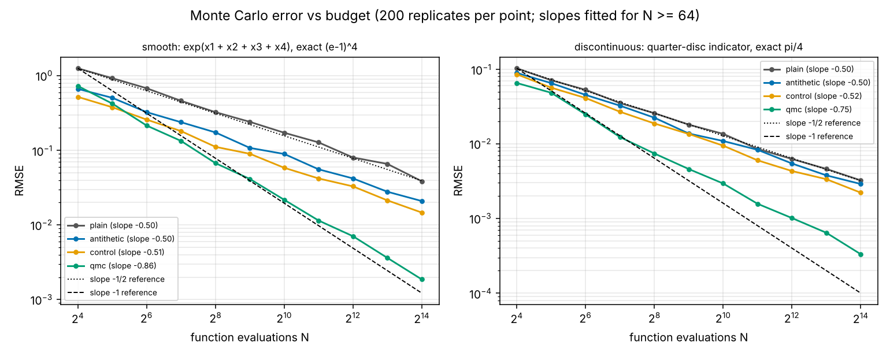

# 03 - Monte Carlo error: how fast it shrinks, and how to make it shrink faster

**Question.** Plain Monte Carlo integration has error that falls like 1/sqrt(N). Which standard tricks actually change that rate, which only change the constant, and does it depend on how smooth the integrand is?

## Setup

Four estimators of an integral over the unit cube, each given the same budget of **N evaluations of the integrand**:

| Estimator | What it does |
|-----------|--------------|
| `plain` | Average of f at N uniform random points |
| `antithetic` | N/2 random points u, each paired with its mirror image 1 - u |
| `control` | Plain average, corrected using g(x) = sum of coordinates, whose mean d/2 is known exactly. The coefficient is estimated from the same sample |
| `qmc` | The first N points of the Halton sequence with a fresh random shift (Cranley-Patterson rotation) in every replicate |

Two integrands with exact answers:

- **smooth:** exp(x1 + x2 + x3 + x4) over the 4D cube, exact value (e - 1)^4.
- **discontinuous:** indicator of the quarter disc x1^2 + x2^2 <= 1 over the 2D square, exact value pi/4. Equivalent to estimating pi.

For N = 2^4 up to 2^14 we repeat each estimate 200 times, compute the root-mean-square error (RMSE) against the exact value, and fit a straight line to log RMSE against log N (using N >= 64).

## Reproduce

```bash
python -m venv .venv && source .venv/bin/activate
pip install -r requirements.txt

python test_experiment.py            # sanity checks, a few seconds
python experiment.py                 # about 5 s on a laptop-class CPU
python experiment.py --reps 500 --max-log2n 16 --out results/big   # tighter estimates
```

Everything is seeded (`--seed`, default 0). Outputs: `results/summary.csv` (RMSE and bias for every integrand, method and N) and `results/error_vs_budget.png`. The committed files are from the plain `python experiment.py` command.

## Results



Fitted log-log slope of RMSE against N (plain Monte Carlo theory says -0.5):

| Integrand | plain | antithetic | control | qmc |
|-----------|-------|------------|---------|-----|
| smooth (4D) | -0.50 | -0.50 | -0.51 | **-0.86** |
| discontinuous (2D) | -0.50 | -0.50 | -0.52 | **-0.75** |

RMSE at N = 16384:

| Integrand | plain | antithetic | control | qmc |
|-----------|-------|------------|---------|-----|
| smooth (4D) | 0.0386 | 0.0209 | 0.0147 | 0.00187 |
| discontinuous (2D) | 0.00324 | 0.0029 | 0.00222 | 0.000332 |

What stands out:

1. **Antithetic and control variates change the constant, not the rate.** Their slopes sit at about -0.5, like plain Monte Carlo. On the smooth integrand they cut error at N = 16384 by about 1.8 times and 2.6 times; on the discontinuous one by only about 1.1 and 1.5 times.
2. **Randomised quasi-Monte Carlo changes the rate.** Slopes of -0.86 and -0.75 mean the gap to plain Monte Carlo keeps widening with N. At N = 16384 it is about 21 times smaller error on the smooth integrand and about 10 times on the discontinuous one.
3. **QMC's slope is lower on the discontinuous integrand** (-0.75 against -0.86), which fits the known sensitivity of QMC to discontinuities. The two integrands differ in dimension as well as smoothness, so this experiment alone does not isolate the cause.
4. **QMC does not win at small budgets.** At N = 16 the control variate is better than QMC on the smooth integrand (see the left edge of the left plot). The advantage appears as N grows.

## Limits of this experiment

- Two integrands and two dimensions. QMC's advantage is known to depend on dimension and on the integrand; we have not mapped that.
- Slopes come from 200 replicates and 9 points (N = 64 to 16384). They carry some sampling error, so differences of a few hundredths should not be read as real; the gaps between QMC and the rest are well beyond that.
- The control-variate coefficient is estimated from the same sample, which introduces a small bias of order 1/N. The test suite checks that all four estimators are unbiased to within sampling noise at N = 256, but bias at smaller N is not separately characterised (it is recorded in `summary.csv`).
- Halton points in higher dimensions have well-known correlation problems; we only go up to 4D.
- Cost is counted in integrand evaluations only. Generating Halton points, or computing the control variate, is not charged.

## Things to try

- Raise the dimension of the smooth integrand and watch the QMC slope: edit `INTEGRANDS` (it needs `fn`, `d`, `truth`). Halton is implemented up to 10 dimensions.
- Swap in scrambled Sobol points from `scipy.stats.qmc` and compare with Halton.
- Add importance sampling, or stratified sampling, as a fifth estimator.
- Add an integrand with a singularity (such as 1/sqrt(x)) and see which estimators survive.
- Add a "confidence interval coverage" check: does the usual +/-1.96 standard-error interval cover the truth 95% of the time for each estimator?

## Files

| File | What it is |
|------|------------|
| `experiment.py` | Integrands, Halton sequence, estimators, sweep, slope fit, plot and command line |
| `test_experiment.py` | Halton values, exact-integral checks, unbiasedness, reproducibility |
| `requirements.txt` | NumPy and Matplotlib |
| `results/` | CSV and figure from the default command |
